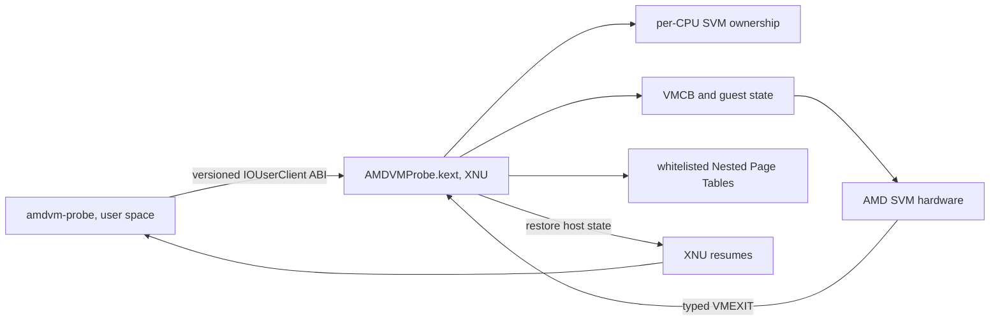

# osx-svm-poc: AMD SVM on x86_64 macOS

`osx-svm-poc` explores whether AMD SVM can be entered from a custom XNU kernel extension on an AMD Hackintosh. It contains an IOKit provider and a small user-space client. The central verified result is a constrained guest context making a hardware SVM transition and returning to macOS through `VMEXIT_HLT`.

This is a research proof of concept. It does not run arbitrary operating systems and is not intended for everyday use.

## Why this exists

On x86, macOS Hypervisor.framework exposes an interface centered on Intel VMX. AMD processors expose a different hardware interface: SVM (`VMRUN`, VMCB, and Nested Page Tables). Seeing SVM in CPUID does not give a macOS application permission to use it. Privileged instructions and CPU state belong to the kernel, and stock XNU does not expose a ready-made public AMD SVM API.

This PoC investigates the riskiest boundary: a custom IOKit kext detects SVM capabilities, temporarily owns SVM state on one CPU, enters a tightly constrained guest context, handles its exit, and returns control to XNU. QEMU is outside this repository; this project publishes the provider and its validation tools.

## Architecture

- **`amdvm-probe`** opens `AMDVMProbeService` and calls versioned ABI methods. The ordinary query reads CPUID/MSR state and does not enable SVM.
- **IOUserClient** restricts access to administrators and validates structure sizes and ABI versions.
- **SVM owner** checks SVM/NPT capability and existing per-CPU ownership. Its lease manages `EFER.SVME` and `VM_HSAVE_PA` and verifies restoration.
- **VMCB** describes guest CPU state, intercept policy, and the reason for VMEXIT.
- **NPT** restricts guest access to explicitly mapped pages. Without NPT, a guest physical address may reach host memory.
- **XSTATE/assembly boundary** transfers FPU/SIMD state and saves selected host CPU state around `VMRUN`.
- After exit, the provider returns a typed result to its client. A larger VMM could handle the event and resume the guest; the QEMU implementation is not included here.

## What has been demonstrated

The recorded hardware target was one AMD Ryzen 7 5700X system with 16 logical CPUs running macOS Tahoe / Darwin 25 on x86_64. This is evidence for one machine and boot configuration, not a compatibility claim for every AMD Hackintosh.

In October 2026, a fixed one-page guest payload was tested: the provider executed `VMRUN`, received the expected `VMEXIT_HLT` (`0x78`), released its context, and returned to the shell. Before entry, the capability query saw SVM/NPT on all 16 CPUs, and the FPU preflight passed. That record applies to the specific kext build loaded at the time. Its UUID and binary are not included here; the exported source must be built and checked independently.

Source-level checks cover NPT mappings, VMCB state round-tripping, XSTATE/events, lifecycle, and quarantine. These exercise software logic and do not replace a hardware VMRUN.

| Evidence level | What it supports | What it does not support |
|---|---|---|
| Kext build | Sources compile for the selected SDK | Loading, safe world switching, or a correct guest |
| Source-level checks | Logic in specific helpers and structures | Hardware behavior in XNU or on the CPU |
| CPUID/MSR query | SVM/NPT capability and per-CPU state | That this provider executed VMRUN |
| HLT hardware smoke | One constrained SVM entry/exit on the tested build and machine | Arbitrary OS execution, Alpine boot, SMP, or production safety |

## Status and limitations

- The research target is AMD x86_64; Intel and Apple Silicon are outside this code's scope.
- The known hardware baseline is one Ryzen 7 5700X system and one macOS Tahoe release.
- The normal build keeps arbitrary SVM entry gated. Separate opt-in targets compile experimental entry code; that does not make running it safe.
- The kext depends on unsupported, version-sensitive XNU/KPI, SDK, and signing/loading details. Apple deprecates kernel extensions and recommends system extensions where suitable; this project needs privileged CPU access and remains kernel research. Read [Apple's current guidance](https://developer.apple.com/support/kernel-extensions) and [loading policy](https://support.apple.com/guide/deployment/system-extensions-in-macos-depa5fb8376f/web). Audit and verify it on the target OS build.
- The current design review still identifies incomplete host-state recovery if an exception occurs during part of the world switch; DR6 is not restored bit-for-bit in every path. Safety for arbitrary guest code is not claimed.
- The guest-memory-type profile is limited: backed memory was treated as WB in the firmware experiment, rather than reproducing every MTRR/PAT combination.
- SMP, hotplug, migration, production interrupt/APIC behavior, persistent multi-vCPU execution, and arbitrary VMs are not claimed.
- Do not change SIP, AMFI, or boot settings to force this PoC to run. Installing/approving a third-party kext and rebooting require an informed decision by the machine owner. This export contains no installer.

## Repository layout

- [`../../src/amdvm-provider/`](../../src/amdvm-provider/) — kext, ABI, provider helpers, and mock headers.
- [`../../src/tools/`](../../src/tools/) — checks wired into the provider Makefile.
- [Build and run](build-and-run.md) — prerequisites and commands.
- [Third-party notes](../../THIRD_PARTY.md) — external components and licensing.

## License

This project is distributed under the **GNU General Public License, version 2 or (at your option) any later version** (`GPL-2.0-or-later`). The full text is in [`LICENSE`](../../LICENSE). When distributing a modified version or binary build, you must follow the GPL terms, preserve copyright and license notices, and provide recipients with the corresponding source under the GPL terms. The license does not require a separate `osx-svm-poc` credit in an app's UI or advertising. See the [official GNU GPL v2 text](https://www.gnu.org/licenses/old-licenses/gpl-2.0.html).

## Next stage

This repository answers a narrow question: can a constrained AMD SVM entry/exit be performed through a custom provider on x86_64 macOS? A VMM must separately connect a vCPU ABI to CPU state, memory, firmware, devices, and guest stop control. QEMU may become a companion project after the provider and its runtime safety gates are stable.
