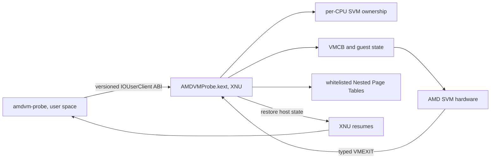

# osx-svm-poc: AMD SVM на macOS x86_64

`osx-svm-poc` исследует, можно ли вызвать аппаратную виртуализацию AMD SVM из собственного XNU kernel extension на AMD Hackintosh. В проекте есть IOKit provider и небольшой user-space клиент. Главный подтверждённый результат — ограниченный учебный гость выполнил аппаратный SVM-переход и вернулся в macOS через `VMEXIT_HLT`.

Это исследовательский PoC. Он не запускает произвольную ОС и не предназначен для повседневного использования.

## Зачем это нужно

На x86 macOS Hypervisor.framework предоставляет интерфейс, ориентированный на Intel VMX. У AMD процессора другой аппаратный интерфейс — SVM (`VMRUN`, VMCB и Nested Page Tables). Наличие SVM в CPUID не даёт приложению macOS права использовать его: привилегированные инструкции и состояние процессора контролирует kernel, а штатный XNU не предоставляет готовый публичный AMD SVM API.

PoC проверяет наиболее рискованную границу: собственный IOKit kext обнаруживает возможности SVM, временно получает право управлять SVM-состоянием одного CPU, запускает строго ограниченный guest context, обрабатывает выход и возвращает управление XNU. QEMU сюда не входит: этот репозиторий публикует provider и инструменты его проверки.

## Архитектура

- **`amdvm-probe`** открывает сервис `AMDVMProbeService` и вызывает версионированные методы ABI. Обычный query только считывает CPUID/MSR-состояние CPU и не включает SVM.
- **IOUserClient** ограничивает доступ уровнем администратора и проверяет размеры и версии структур.
- **SVM owner** проверяет поддержку SVM/NPT и занятость per-CPU state. Lease управляет `EFER.SVME` и `VM_HSAVE_PA` и проверяет их восстановление.
- **VMCB** описывает состояние guest CPU, intercept-политику и причину VMEXIT.
- **NPT** ограничивает доступ гостя явно отображёнными страницами. Без NPT guest physical address может обратиться к памяти хоста.
- **XSTATE/assembly boundary** передаёт FPU/SIMD-состояние и сохраняет часть host CPU state вокруг `VMRUN`.
- После выхода provider возвращает типизированный результат клиенту. Большая VMM могла бы обработать событие и продолжить гостя; QEMU в этом проекте отсутствует.

## Что подтверждено

Записанная аппаратная проверка выполнялась на одной системе: AMD Ryzen 7 5700X, 16 логических CPU, macOS Tahoe / Darwin 25, x86_64. Это подтверждение для одной машины и boot configuration, а не заявление о совместимости со всеми AMD Hackintosh.

В октябре 2026 был проверен фиксированный одностраничный guest payload: provider выполнил `VMRUN`, получил ожидаемый `VMEXIT_HLT` (`0x78`), освободил контекст, а вызов вернулся в shell. Перед запуском query видел SVM/NPT на всех 16 CPU; FPU preflight прошёл. Запись относится к конкретному собранному и загруженному тогда kext. Его UUID и бинарный файл в этот экспорт не включены; текущий исходник необходимо собрать и проверить отдельно.

Есть source-level проверки NPT mapping, VMCB state round-trip, XSTATE/events, lifecycle и quarantine. Они проверяют программную логику, но не заменяют VMRUN на железе.

| Уровень | Что показывает | Чего не показывает |
|---|---|---|
| Сборка kext | Исходники компилируются для выбранного SDK | Загрузку, безопасный world switch или корректный guest |
| Source-level проверки | Логику конкретных helpers и структур | Аппаратное поведение XNU/CPU |
| CPUID/MSR query | SVM/NPT доступны и текущее состояние per-CPU | Что provider смог выполнить VMRUN |
| HLT hardware smoke | Один ограниченный SVM entry/exit на проверенном кандидате и машине | Загрузку полноценной ОС, SMP или production safety |

## Статус и ограничения

- Цель — AMD x86_64; Intel и Apple Silicon вне области этого кода.
- Аппаратная база — одна система с Ryzen 7 5700X и конкретным выпуском macOS Tahoe.
- Обычная сборка блокирует произвольный SVM entry. Отдельные opt-in targets компилируют экспериментальный код, но это не делает запуск безопасным.
- Kext зависит от внутренних и неподдерживаемых деталей XNU/KPI, SDK и политики подписи/загрузки. Apple считает kernel extensions устаревающим механизмом и рекомендует system extensions там, где они подходят; этот проект требует привилегированного доступа к CPU и остаётся исследованием kernel. Смотрите [актуальные указания Apple](https://developer.apple.com/support/kernel-extensions) и [правила загрузки](https://support.apple.com/guide/deployment/system-extensions-in-macos-depa5fb8376f/web). Нужны аудит и проверка на целевой версии ОС.
- В текущем design review остаётся неполный путь восстановления host state при исключении во время части world switch. DR6 также не во всех путях сохраняется побитно. Безопасность произвольного guest code не заявляется.
- Профиль guest memory type ограничен: в firmware-эксперименте отображённая память трактуется как WB, без полного воспроизведения всех MTRR/PAT комбинаций.
- SMP, hotplug, migration, production interrupt/APIC semantics, долгоживущие многопоточные vCPU и произвольные VM не заявляются.
- Не меняйте SIP, AMFI или параметры загрузки, чтобы запустить этот PoC. Установка/разрешение стороннего kext и перезагрузка требуют осознанного решения владельца машины. Установочных скриптов нет.

## Файлы проекта

- [`../../src/amdvm-provider/`](../../src/amdvm-provider/) — kext, ABI, provider helpers и mock-заголовки.
- [`../../src/tools/`](../../src/tools/) — проверки, подключённые к Makefile provider.
- [Сборка и запуск](build-and-run.md) — требования и команды.
- [Third-party notes](../../THIRD_PARTY.md) — внешние компоненты и лицензии.

## Лицензия

Проект распространяется по **GNU GPL версии 2 или, по выбору получателя, любой более поздней версии** (`GPL-2.0-or-later`). Полный текст — в файле [`LICENSE`](../../LICENSE). При распространении производной версии или бинарной сборки нужно соблюдать условия GPL, сохранять уведомления о правах и лицензии и предоставить соответствующий исходный код получателям на условиях GPL. Лицензия не требует отдельного упоминания `osx-svm-poc` в интерфейсе или рекламе. См. [официальный текст GNU GPL v2](https://www.gnu.org/licenses/old-licenses/gpl-2.0.html).

## Следующий этап

Этот репозиторий отвечает на узкий вопрос: возможен ли ограниченный AMD SVM entry/exit через собственный provider на x86_64 macOS? VMM должна отдельно связать vCPU ABI с состоянием CPU, памятью, firmware, устройствами и остановкой guest. QEMU может стать companion-проектом после стабилизации provider и проверки его runtime safety gates.
